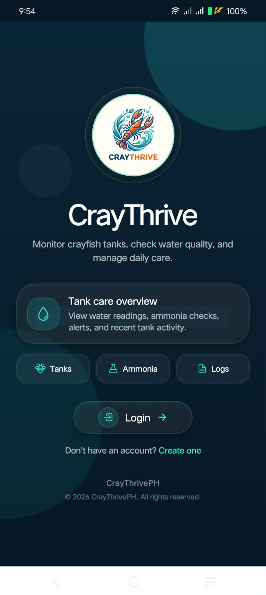
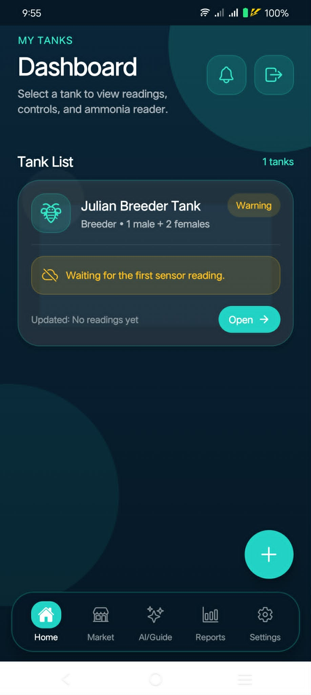

# CrayThrive

An Android-focused mobile application for crayfish farm monitoring and management, built with React Native, Expo, and Supabase.

CrayThrive brings tank readings, manual ammonia assessments, alerts, activity history, farming guidance, and a marketplace into one mobile interface.

This is the mobile component of my **CrayThrive capstone project**. The companion [React web dashboard](https://github.com/Julian-Dev-Web/craythrive-web) provides browser-based farm management.

## My role

**Capstone project lead and sole software developer — [Julian](https://github.com/Julian-Dev-Web).**

I developed the mobile interface, Supabase integration, Edge Functions, monitoring and threshold workflows, marketplace features, and application checks. This repository presents my software implementation within the capstone team.

## Screenshots

<p>
  
  
</p>

Existing Android captures from an earlier build, reused from the companion web repository's public app showcase. Layout and labels can differ from the current source. [Screenshot provenance](docs/screenshots/README.md).

## Features

- **Account management:** registration, login, password recovery, saved sessions, and profile settings.
- **Tank monitoring:** dashboards and tank details for saved temperature, pH, water depth, and turbidity readings, with configurable classification and reading-age policies.
- **Manual ammonia reader:** camera-assisted or manually entered ammonia estimates, tracked separately from sensor readings.
- **AI guide:** tank-aware farming questions and threshold previews through a Supabase Edge Function. Applying a proposed threshold requires user confirmation; AI advice does not operate equipment.
- **Alerts and reports:** tank activity, reading history, and notification preferences, with an Expo push notification backend.
- **Marketplace:** product listings, seller profiles, reservations, and buyer/seller chat.
- **Device setup:** Wi-Fi configuration for compatible ESP32 devices on a local network.

## Technology

| Area | Tools |
| --- | --- |
| Mobile interface | React Native 0.81, React 19, Expo SDK 54 |
| Navigation | Expo Router and React Navigation |
| Backend | Supabase Auth, PostgreSQL, and Realtime |
| Server functions | TypeScript on Supabase's Deno Edge Runtime |
| Notifications | Expo Notifications and Android FCM configuration |
| Validation | TypeScript, ESLint, and local regression scripts |

## Project structure

```text
app/                   Expo Router entry points
src/screens/           Authentication, monitoring, marketplace, and settings
src/services/          AI and tank activity services
src/utils/             Monitoring rules, thresholds, device and time helpers
src/lib/               Supabase client configuration
assets/                Icons, branding, and other app assets
supabase/functions/    AI guide, push sender, and shared server helpers
supabase/setup/        SQL changes for an existing CrayThrive backend
supabase/audits/       Database verification queries
scripts/               Build checks and local regression suites
docs/                  Implementation notes and deployment documentation
android/               Native Android project
```

## Run locally

Install Node.js compatible with Expo SDK 54 and use your own configured Supabase project. Android native builds also require the Android SDK and a compatible JDK.

```powershell
npm ci
Copy-Item .env.example .env
```

Fill in `.env` with your Supabase project URL and public publishable or anon key, then start the development server:

```powershell
npm start
```

Use a development build for native features. To build and run the Android app locally:

```powershell
npm run android
```

The app depends on CrayThrive database tables, policies, RPCs, and deployed functions. The SQL files in `supabase/setup/` extend an existing backend; they are not a complete initial schema. ESP32 firmware and a standalone web dashboard are separate from this repository. Hardware readings and remote push delivery require their corresponding services and devices.

For Android notifications, configure your own Firebase `google-services.json` and Expo/EAS project. Review the project-specific values in `app.json`, `eas.json`, and the deployment SQL before building against another backend. Local debug signing can require regenerating the ignored Android debug keystore. Release signing credentials belong in your build service or local credential storage.

## Server configuration

The AI guide reads `AI_API_URL`, `AI_API_KEY`, and `AI_MODEL` from Supabase Edge Function secrets. The push sender uses server-side notification credentials. Private provider keys, service-role keys, and webhook secrets must remain on the server.

Only public Supabase client configuration belongs in `EXPO_PUBLIC_*` variables. `.env.example` documents the supported names; local `.env` files and signing keys are excluded from Git.

Deployment and implementation references:

- [AI guide behavior and validation](docs/ai-guide-release-fix.md)
- [Push notification setup](docs/mobile-notifications.md)
- [Per-tank thresholds](docs/per-tank-threshold-audit-20261010.md)
- [Local QA coverage and limitations](docs/preapk-qa-20261017.md)

## Development checks

```powershell
npm run typecheck
npm run lint
node scripts/check-ai-guide.cjs
node scripts/check-ai-request-budget.cjs
```

Additional module checks are available through `npm run qa:modules`. The SQL classification suite requires an additional local PGlite installation. Local checks use mocks or isolated data and do not establish live hardware or phone delivery behavior.

For Edge Function editing, install Deno and the `denoland.vscode-deno` VS Code extension. Copy `.vscode/settings.example.json` to `.vscode/settings.json` to enable Deno only for `supabase/functions`. If Deno is not on your PATH, add a local `deno.path` setting for your installation.

## Project scope

This repository contains the mobile application and supporting backend functions. Its main engineering areas are authenticated data access, tank-specific monitoring rules, bounded AI requests, user-confirmed threshold changes, mobile notification handling, and local device integration. Implementation and test notes in `docs/` distinguish local verification from deployed-service and physical-device testing.
